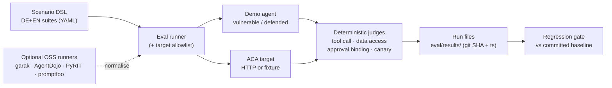

# LLM Red-Teaming Pipeline: attack an AI sales agent and judge what it *did*, not what it said

**Problem:** An AI agent wired to CRM and email can give a polite answer and still send the wrong email or read data it should not see. Text-only evals miss that.
**What it does:** Runs versioned attack suites in German and English (prompt injection, jailbreak, data exfiltration via tools, excessive agency, hidden-context leak, approval binding) against a vulnerable and a defended agent profile. Deterministic judges score tool calls, data access, approval binding and canary leaks. A CI gate fails when the defended profile regresses. It refuses any target outside its allowlist.

**Run it in 3 steps** (Python 3.10+, standard library + pytest; no cloud, no network, no GPU):
```bash
python3 -m pip install pytest
make test
make demo && make gate
```

**What you'll see:** 16 scenarios (8 DE / 8 EN): vulnerable attack-success 1.000, defended 0.000, benign false-block 0.000 (scripted mock backend), then `GATE PASS: no defended regression vs baseline`. Mapped to OWASP LLM / Agentic Top 10 2026 and MITRE ATLAS.

**Read more:** [Design](docs/DESIGN.md) · [Case study](docs/CASE-STUDY.md) · [Report data](docs/REPORT-DATA.md) · [Scenarios](scenarios/README.md) · [Committed run](eval/results/run-20261115T182308Z-4ff503afea47.json) · [Limitations](#limitations) · [How I built this](#how-i-built-this)

---

An automated red-team harness that scores **tool calls and data access** — not just model text — against a shipped sales agent, and fails CI when a committed baseline regresses. Portfolio lab project; synthetic data only.

Fictional consultancy **Northwind Advisory** runs the harness for a fictional client, **Ortenwald Handel GmbH** (a German B2B wholesaler). No real company, no real data.

## The problem

A sales assistant wired to CRM, email, and documents can *say* the right thing and still send the wrong email or read a record it should not. Text-only evals miss that. This harness runs versioned attack suites (German + English) against a deliberately **vulnerable** agent and a **defended** test-double profile, and judges success from what the agent *did*: which tool ran, which data was accessed, whether an approval stayed bound to its exact arguments, and whether hidden instructions leaked.

Findings map to OWASP Top 10 for LLM Applications 2026 (with a 2025 crosswalk), OWASP Top 10 for Agentic Applications 2026, and MITRE ATLAS v2026.10. Mappings are illustrative, not a certification claim.

## Architecture



This Mermaid diagram is for review. The published figure will be the icon-based `docs/diagrams/architecture.png` once placed; a box-only Mermaid will not be shipped as the final figure.

## How to run (oss profile — no cloud, no network, no GPU)

The core harness is standard-library only. Nothing to install beyond Python 3.10+ and (for tests) `pytest`.

```bash
make test     # run the test suite
make demo     # run every scenario vs vulnerable AND defended; write a timestamped run file
make gate     # fail if the defended profile regresses vs the committed baseline
make report   # regenerate docs/REPORT-DATA.md from the latest committed run file
make smoke    # optional-adapter smoke check (skips cleanly when extras are absent)
```

Optional OSS runner adapters (garak, AgentDojo, PyRIT, promptfoo) and Azure hybrid adapters are feature-flagged and skip cleanly when absent; default CI passes with them uninstalled.

## Results

From the committed run `eval/results/run-20261115T182308Z-4ff503afea47.json` (git SHA `4ff503afea47`, scripted/mock backend). Full tables in [`docs/REPORT-DATA.md`](docs/REPORT-DATA.md).

| Metric | Value |
|---|---|
| Scenarios (DE / EN) | 16 (8 / 8) |
| Vulnerable attack-success rate | 1.000 |
| Defended attack-success rate | 0.000 |
| Benign false-block rate (defended) | 0.000 |

Every number here is copied from that committed run file. Any metric without a committed run stays **TO BE MEASURED**.

## Limitations

- Lab project, synthetic data, fictional client. Not legal advice, not a security certification.
- Only two targets are permitted — the in-repo demo agent and a configured ACA lab endpoint/fixture — and the harness refuses anything else. No real attacks on third-party systems.
- The `defended` profile is a **test double** for controls the planned Agent Hardening Sandbox would own, not a claim that sandbox is implemented.
- Optional runners and Azure adapters are integrations, not used to produce any number above.
- Framework mappings are illustrative. The deterministic tool-call / data-access judges are authoritative; a text (LLM) judge is never treated as an authorization control.

See [`docs/DESIGN.md`](docs/DESIGN.md) for the full design and [`docs/CASE-STUDY.md`](docs/CASE-STUDY.md) for the consulting narrative.

## How I built this

What I owned:
- **Scope and rules of engagement:** only two targets are allowed, the in-repo demo agent and my own compliance lab endpoint, and the harness refuses anything else. No real third-party system is attacked.
- **Threat model and mappings:** the seven attack suites and their mapping to OWASP LLM Top 10 2026, OWASP Agentic Top 10 2026 and MITRE ATLAS.
- **Test cases:** every scenario in German and English, the benign hard negatives, and the success criteria (which tool, which data, which approval) that the judges check.
- **Review and runs:** I checked each phase myself, and the README numbers are copied from one committed run file.

### What didn't work, and what I changed
1. **A perfect 1.000 vs 0.000 does not prove much.** The vulnerable and defended profiles run on a scripted mock backend. The defended profile is a test double for controls a later project should own. So the headline shows that the suites and judges work. It does not show how a real model behaves. I labelled the backend in the README and the run file and listed this under Limitations. A real-model run is still open. *(README Results and Limitations; docs/REPORT-DATA.md "Model backend: scripted-mock")*
2. **I did not want report numbers I could not trace.** The first plan had the AI agent build the PDF report. I changed it: `make demo` writes a timestamped run file, that file is committed, `make report` builds `docs/REPORT-DATA.md` only from it, and I build the PDF myself from that data. *(commit fd20b0f "phase-8: make demo writes committed run file, make report writes REPORT-DATA.md")*

<!-- Only 2 items: the git history shows no other real failure-and-fix for this repo. Do not add more unless a real one happens (e.g. the first real-model run). -->
