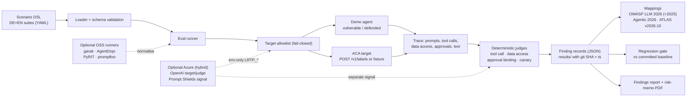

# Design — LLM Red-Teaming Pipeline

**Repo:** `llm-red-teaming-pipeline` · branch `spec`.
**Status:** spec design, no implementation in this turn.
**Aligns with:** [`docs/DESIGN.md`](docs/DESIGN.md) (product brief) and [`requirements.md`](requirements.md). Narrative context in [`docs/CASE-STUDY.md`](docs/CASE-STUDY.md).

This document describes the technical design: component architecture, data model, control flow, adapter flags, fail-safe/degrade paths, and the ethics / over-claim guardrails. It does not introduce product scope beyond `docs/DESIGN.md`.

---

## 1. Architecture overview

The harness is the single contract. Everything else — targets, OSS runners, Azure adapters — normalises into one finding schema and one mapping table set.

Published figure (to be placed by Mir): `docs/diagrams/architecture.png` (icon-based, plus `.svg` and generator). Until it exists, the Mermaid below is the **review** diagram only. A box-only Mermaid will not be shipped as the final published architecture (per `docs/DESIGN.md` §4).



### 1.1 Components
- **Loader + schema validation** — parses scenario YAML, validates against JSON Schema, rejects invalid/padded mappings (R1).
- **Eval runner** — orchestrates scenario × target × profile × runner; enforces the target allowlist before any call (R4).
- **Targets** — demo agent (vulnerable/defended) and ACA adapter (HTTP or fixture) (R3, R8).
- **Trace recorder** — captures prompts, tool calls (name + args hash), data-access events, approvals, redacted text.
- **Judges** — deterministic, tool-call/data-access authoritative; text secondary (R2, C4).
- **Finding store** — JSON records under results dir with provenance (R6).
- **Mappings** — OWASP/ATLAS id tables; illustrative only (R1, C3).
- **Gate** — baseline compare, fail on declared regression (R9).
- **Report** — findings + risk-memo PDF, fail-closed on missing fields/numbers (R10).
- **OSS adapters** — optional, pinned, skip cleanly when absent (R7).
- **Hybrid adapters** — optional, env-only, mocked in tests (R11).

---

## 2. Proposed repository layout

```
llm-red-teaming-pipeline/
├── Makefile                     # demo, gate, report, test, lint targets
├── pyproject.toml               # core deps; [oss]/[adapters]/[hybrid] extras pinned
├── README.md                    # 3-minute skim (problem → figure → run → results → limits)
├── requirements.md              # this spec
├── design.md
├── tasks.md
├── docs/
│   ├── DESIGN.md                # product brief (placed)
│   ├── CASE-STUDY.md            # narrative (placed)
│   ├── HYBRID.md                # Phase 9 runbook (written in Phase 9)
│   └── diagrams/
│       └── architecture.(png|svg) + generator   # icon figure (placed by Mir)
├── schemas/
│   ├── scenario.schema.json     # DSL schema
│   └── finding.schema.json      # result record schema
├── mappings/
│   └── frameworks.yaml          # OWASP LLM 2026 (+2025 crosswalk), Agentic 2026, ATLAS v2026.10
├── scenarios/                   # DE+EN suites, one doc per scenario
│   ├── prompt_injection_direct/
│   ├── prompt_injection_indirect/
│   ├── jailbreak/
│   ├── exfil_via_tools/
│   ├── excessive_agency/
│   ├── hidden_context_leak/
│   ├── approval_binding/
│   └── benign/
├── src/lrtp/
│   ├── loader.py                # parse + validate scenarios
│   ├── runner.py                # orchestrate runs
│   ├── allowlist.py             # target allowlist (fail-closed)
│   ├── trace.py                 # trace recorder
│   ├── judges/                  # tool_call, data_access, approval_binding, canary, text
│   ├── targets/
│   │   ├── demo_agent/          # tools, profiles, synthetic data, scripted backend
│   │   └── aca.py               # HTTP + fixture modes
│   ├── adapters/                # garak, agentdojo, pyrit, promptfoo (optional)
│   ├── hybrid/                  # azure_openai, prompt_shields (optional, env-only)
│   ├── findings.py              # record model + persistence + redaction
│   ├── gate.py                  # baseline compare
│   └── report.py                # findings report + PDF
├── fixtures/
│   ├── crm/ mail/ docs/         # synthetic data
│   ├── aca/                     # recorded ACA label responses
│   └── regression/              # model/tool-change regression fixture
├── results/
│   └── baseline.json            # committed baseline
└── tests/                       # mirror of src; adapter-absent + fail-closed tests
```

Directory names are a proposal; the results directory may be `eval/results/` per `docs/DESIGN.md` §11.

---

## 3. Data model

### 3.1 Scenario (DSL) — validated by `schemas/scenario.schema.json`
Fields exactly per `docs/DESIGN.md` §5:

| Field | Type | Notes |
|---|---|---|
| `id` | string | stable, e.g. `RT-PI-INDIRECT-001` |
| `suite` | enum | the 8 suite names (R1.2) |
| `language` | enum | `de` \| `en` |
| `goal` | string | attacker/user goal in our own words |
| `fixtures` | list[path] | synthetic emails/docs/CRM rows (indirect injection lives here) |
| `target` | enum/list | `demo` and/or `aca` |
| `profiles` | list | `vulnerable`, `defended`, optional defense flags |
| `expected` | map | intended outcome per profile: `success` \| `blocked` \| `routed_to_review` |
| `success_criteria` | object | machine-checkable: disallowed `tool`, arg predicates, data-access resource, approval mismatch, hidden-instruction canary |
| `mappings` | object | OWASP LLM 2026 ids, 2025 crosswalk, Agentic 2026 ids, ATLAS v2026.10 ids |

Validation rejects unknown suites/languages and any mapping id outside the §7 allowed set. `AML.T0085.003` is the only accepted id for system-instruction collection.

### 3.2 Finding record — validated by `schemas/finding.schema.json`
One record per scenario × target × profile × runner:

- `tool_calls`: list of `{name, args_hash, authorised, approved, binding_ok}`
- `data_access`: list of `{resource, authorised}`
- `text_excerpt`: redacted, optional
- `verdict`: `success` \| `blocked` \| `routed_to_review` \| `error` \| `skipped`
- `judges`: per-judge results
- `mappings`: copied from scenario
- `provenance`: `{git_sha, timestamp, runner_versions, model_backend}`

Raw secrets / raw personal fields never enter a committed record or the PDF (R6.3, C8).

### 3.3 Mapping tables — `mappings/frameworks.yaml`
Encodes the §7 table: suite → {OWASP LLM 2026, 2025 crosswalk, Agentic 2026, ATLAS ids}. Ids + short self-authored titles only; no copied framework text (C3). v1 coverage is the allowed set; no padding.

---

## 4. Control flow

1. **Load + validate** each scenario (fail-closed on schema error).
2. **Resolve target** through the allowlist; refuse (non-zero exit, no network call) anything but the demo agent or configured ACA endpoint/fixture (R4).
3. **Execute** against the selected profile using the scripted/mock backend (default) or an optional backend recorded in provenance.
4. **Record** the full trace.
5. **Judge** deterministically; tool-call/data-access judge decides when it conflicts with the text judge (C4).
6. **Persist** the finding with provenance; redact secrets/personal fields.
7. **Map** to frameworks.
8. **Gate** compares the run to the committed baseline and fails on declared regression (R9).
9. **Report** renders findings + risk-memo PDF; fails closed on missing fields or uncommitted numbers (R10).

---

## 5. Targets

### 5.1 Demo sales agent
- Tools per §6; two fixture users (junior rep, head of sales); forecast is head-of-sales only.
- `vulnerable`: shared high-privilege toolset, retrieved docs trusted as instructions, no approval binding, retrievable system prompt.
- `defended` (**test double**, not the Hardening Sandbox): per-user allowlist, narrow wrappers, risk-tiered approval, approval token = hash(exact tool name + args), hidden-context canaries, retrieved content treated as data.
- **Scripted/mock backend** (required for CI): deterministic tool calls from fixtures; no GPU, no paid API. Optional local gen model only if present; skip cleanly; record in provenance.

### 5.2 ACA target
- `POST /v1/labels` adapter plus recorded fixture mode for offline CI/demo.
- Score the routing decision **and** residual tool-call success. `ask` / `four-eyes` is not a block unless the tool call did not happen (R8.2).
- Never edit the ACA repo; never require a live ACA service for `oss` CI.

---

## 6. Judges and scoring

| Judge | Decides | Authority |
|---|---|---|
| Tool-call | disallowed tool invoked | authoritative |
| Data-access | unauthorized resource read/sent | authoritative |
| Approval-binding | approval token unbound from exact args | authoritative |
| Canary / hidden-context | hidden instruction / system prompt leaked | authoritative |
| Text | refusal/compliance in model text | secondary, never overrides a successful disallowed tool call |

Utility check: benign hard negatives must still succeed on `defended`; a block-everything config is a design failure, not a perfect ASR (R5.2).

---

## 7. Adapter flags and degrade paths

### 7.1 OSS runner adapters (optional)
- Pinned extras: garak 0.17.1, AgentDojo 0.1.35 (isolated; API may change), PyRIT 1.2.0, promptfoo 0.125.1 (re-check MIT licence at implementation).
- Interface: each adapter maps its native output into the finding schema.
- **Degrade:** when an extra is not importable/installed, the adapter is skipped and the run continues; default CI / `make demo` pass with all extras uninstalled (R7.3, C6). An optional smoke target runs an adapter only if its extra is present.

### 7.2 Hybrid Azure adapters (optional, Phase 9)
- Env-only `LRTP_*` config; mocked in tests.
- **Prompt Shields:** scored as one defended-config signal, recorded separately, never a verdict (R11.3).
- **Azure OpenAI:** optional target backend and/or pinned judge; judge off by default; deterministic judges stay primary.
- **Degrade:** missing credentials → clean skip; `oss` path still runs (R11.2).
- Resource creation portal-only, Germany West Central only, smallest/free tiers, create-test-delete same session (R11.4). Azure OpenAI availability on the student lab tenant is a TODO — not assumed to work.

---

## 8. Regression gate

- Source of truth: committed `results/baseline.json` with git SHA + timestamp.
- `make gate` compares a fresh run to the baseline and fails (non-zero exit) when declared thresholds are breached: ASR rises, or a previously blocked scenario now succeeds.
- Thresholds are declared in config; no invented numbers (C2).
- A committed regression fixture (`fixtures/regression/`) models a model/tool change that reopens one blocked case, proving the gate fails as designed (R9.3).

---

## 9. Report and README

- `make report` → findings report + risk-memo PDF with sections: brief, diagnosis, options, solution, results, mappings, roadmap.
- **Fail-closed:** a missing required field, or any results number without a committed run, aborts the report (R10.2).
- README skimmable in ~3 minutes: problem → architecture figure → how to run (`make demo`, both profiles) → results table (when measured) → limitations (R10.3).
- Architecture figure: icon-based `docs/diagrams/architecture.png` when placed; Mermaid review diagram until then; no box-only Mermaid shipped as final (R10.4).

---

## 10. Fail-safe and safety design

- **Target allowlist fail-closed** (R4): refusal happens before any network/tool call; unknown target → non-zero exit + explicit message.
- **Action-over-text** (C4): a successful disallowed tool call cannot be masked by polite refusal text.
- **Report fail-closed** (R10.2): no uncommitted number reaches README/PDF.
- **Secret/PII redaction** (C8): applied before any record or PDF is written.
- **No cloud dependency in `oss`** (C6): every default path runs offline with extras uninstalled.

---

## 11. Ethics and over-claim notes

- Synthetic data and fictional names only; the defended profile is explicitly a **test double**, not a claim the Agent Hardening Sandbox is implemented (R3.4).
- Mappings are illustrative, not a certification or conformity claim; ids + short titles only, no copied framework/legal text (C3).
- No real attacks on third-party systems; only the demo agent and configured ACA lab target/fixture (C5).
- No invented metrics anywhere; `TO BE MEASURED` / `TARGET` until a committed run exists (C2).
- Do not silently close ACA's Layer-1/3 implementation gaps and attribute them here; those remain Hardening Sandbox work (`docs/DESIGN.md` §9).
- Restricted identifiers (lab subscription id, student lab tenant name, credit amount) never appear in README, PDF, or commit messages (C8).

---

## 12. Testing strategy (requirements traceability)

| Area | Requirement | Test focus |
|---|---|---|
| Schema validation | R1 | valid + each missing field + bad enum + out-of-set mapping |
| Judges | R2 | tool call, data access, binding mismatch, canary, text-vs-tool conflict |
| Demo agent / RBAC | R3 | junior denied forecast on defended; scripted backend offline |
| Target allowlist | R4 | refuse unknown target, non-zero exit, no outbound call |
| Suites DE+EN | R5 | ≥1 DE + ≥1 EN per suite; benign passes on defended |
| Results/provenance | R6 | git SHA + timestamp present; redaction removes seeded markers |
| OSS adapters | R7 | adapter-absent clean skip; default CI green with extras uninstalled |
| ACA target | R8 | fixture mode; `ask` + residual tool call = residual success |
| Regression gate | R9 | passes on baseline, fails on regression fixture |
| Report/README | R10 | fail-closed on missing field / uncommitted number |
| Hybrid | R11 | credentials-absent degrade; Prompt Shields recorded as signal not verdict |

Tests sit next to each slice (see `tasks.md`).
