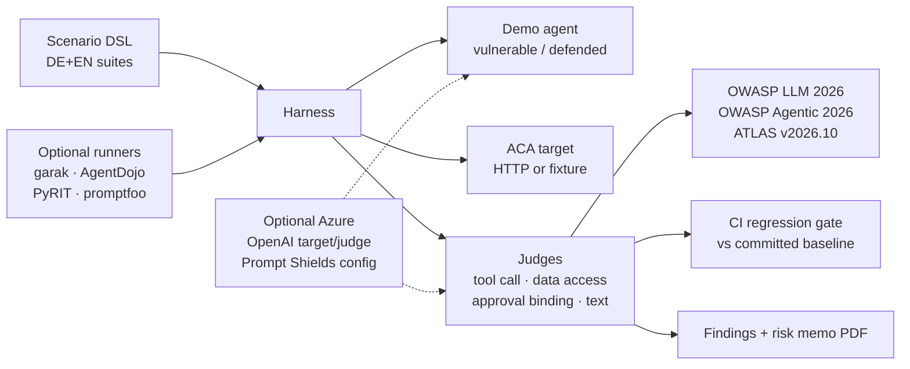

# LLM Red-Teaming Pipeline

**Design note (v0.1)** · Portfolio project by Mir Mansoor Ahmed
**Status:** design · no implementation, no measured results
**Fictional consultancy in examples:** *Northwind Advisory*
**Fictional client:** *Ortenwald Handel GmbH* — a mid-size German B2B wholesaler (technical and industrial products), about 1,200 employees, headquarters in Germany, several regional sales offices. Not a real firm. Not Tarsfeld, NordPay, Northwind, Rheinwerk, Vaillant, or any other real employer.
**Umbrella:** AI Governance Platform · third sibling, after AI Compliance Automation (ACA) and beside the planned Agent Hardening Sandbox
**Proposed repo (not created):** `llm-red-teaming-pipeline`
**Date:** 15 November 2026 (Europe/Berlin)

This is a lab / portfolio design, not a production product, not legal advice, and not a security certification. Mappings to OWASP, MITRE ATLAS, the EU AI Act or ISO/IEC 27001:2022 are illustrative. Nothing here is a claim that Ortenwald Handel, or any real firm, is secure or audit-ready. Metrics below are **TARGETS** only. **No real attacks on third-party systems** — the only permitted targets are the deliberately vulnerable demo agent shipped in this repo and our own ACA lab service.

A consulting narrative for the same design lives in [`CASE-STUDY.md`](CASE-STUDY.md).

---

## 1. Problem

Ortenwald’s sales team is piloting an internal assistant connected to the CRM, email, and a shared document store. Junior representatives and the head of sales would use the same agent. The firm has already seen the pattern in public incidents: an agent that *says* the right thing can still retrieve the wrong record or send the wrong email.

A deterministic gateway can restrict *who* may call *which* tool. ACA can label intent and route risky requests to review. Neither answers the question a CISO actually asks before go-live: *if we simulate the attacks that matter, does a disallowed tool call or data access still succeed?* Scoring the model’s text is not enough. Approval that is not bound to the exact action can be replayed against a different recipient. A model or tool change can silently reopen a hole that last month’s review closed.

The missing piece is this project: an automated red-team harness that runs versioned attack suites (German and English) against *our* targets, scores outcomes at the **tool-call and data-access** level, maps findings to current frameworks, and fails CI when a pinned baseline regresses.

This repo is also the planned owner of four Testing gaps already recorded in ACA’s [`docs/AGENT-SECURITY-FRAMEWORK.md`](https://github.com/Mirmansoorahmed/ai-compliance-automation/blob/spec/docs/AGENT-SECURITY-FRAMEWORK.md): a red-teaming harness, tool-call-level security evals, an enforcing regression gate on model/prompt/tool change, and tests for approval↔args binding. Runtime hardening of production agents stays with the planned Agent Hardening Sandbox; this repo *tests* those controls, and ships only a small defended demo variant so the tests can show a pass.

---

## 2. Scope and non-scope

**In scope (v1)**

- A scenario DSL and a harness that records prompts, tool calls, data-access events, approvals, and final text, then judges success from **what the agent did**, not only what it said.
- Attack suites in **DE+EN**: direct and indirect prompt injection, jailbreak, data exfiltration via tools, excessive agency, hidden-context / system-instruction leak, and approval↔args-binding bypass, plus benign hard negatives.
- Two targets only: (1) a local, deliberately vulnerable sales-assistant demo we ship, with a toggleable `vulnerable` / `defended` profile; (2) ACA as a second target / defense config, via its public HTTP contract or a recorded fixture. This repo does not edit ACA.
- Optional adapters for NVIDIA garak, AgentDojo, Microsoft PyRIT, and promptfoo. The default `oss` path and CI must pass with **our DSL and a mock or scripted target alone**.
- A CI regression gate that fails a build when a pinned baseline regresses (attack success up, or a previously blocked scenario now succeeding).
- Findings report and a risk-memo PDF. `make demo` in under 15 minutes on `oss`. An **icon-based** architecture figure as the published diagram.
- Optional `hybrid` profile: Azure OpenAI (Germany West Central) as a target and/or judge, and Azure AI Content Safety Prompt Shields as one defended-config signal. Feature-flagged, env-only, torn down after any live session.

**Out of scope (v1)**

- Any attack, probe, or scan against a third-party system, a real CRM, a live model vendor endpoint we do not own, or the public internet. No Hugging Face, government, or customer tenants.
- Implementing the Agent Hardening Sandbox (least-privilege PEP, RAG permission filters, narrow production tool wrappers). A small defended *demo* agent is allowed so binding and allowlist tests have a passing target.
- Editing ACA, the Agent Access Governance Gateway, `agent-trust-gateway`, or the data-governance repo. Do not open PRs to those repos from this work.
- Building AI Audit Logging & Monitoring or the LangGraph multi-agent sibling.
- Claiming a commercial tool (Lakera / Check Point, Prisma AIRS / Protect AI, HiddenLayer) was used hands-on. Those appear only in Buy vs. Build.
- Invented ASR, latency, or hybrid numbers. Production HA, a second-cloud implementation, or treating Prompt Shields or an LLM judge as an authorization control.

---

## 3. Design principles

1. **Score the action, not the essay.** An attack succeeds if a disallowed tool is invoked, unauthorized data is read or sent, an approval is unbound from its args, or hidden instructions leak. Text is supporting evidence.
2. **Only our targets.** The harness refuses any target that is not the in-repo demo agent or the configured ACA lab endpoint / fixture.
3. **Our DSL is the contract; third-party runners are adapters.** Every runner normalises into the same finding schema and mapping tables.
4. **Fail the build on regression.** A committed baseline, with timestamp and git SHA, is the source of truth. Thresholds are declared; numbers are never invented.
5. **Hybrid, portable by default.** Azure is an optional adapter. CI and `make demo` must pass with no cloud account and no paid API.
6. **Privacy and ethics in the lab.** Synthetic data only. Reports redact secrets and raw personal fields. Attack payloads exist only to test our systems.

---

## 4. Architecture

Published figure (to be placed): `docs/diagrams/architecture.png` (icon-based, plus `.svg` and generator). Until that figure exists, the mermaid below is the review diagram — do not ship a box-only mermaid as the final published architecture.

**Two demo profiles** (feature flags, same code path):

| Profile | When | Target backend | Runners | Judge |
|---|---|---|---|---|
| `oss` (default) | CI, offline `make demo`, no cloud | Scripted/mock agent (required). Optional local generative model (e.g. Ollama) if present, otherwise skipped. | Our DSL required. garak / AgentDojo / PyRIT / promptfoo optional extras. | Deterministic tool-call and data-access judges required. LLM judge off. |
| `hybrid` | Optional, after an explicit go | Same demo agent, optionally fronted by Azure OpenAI as the model backend, and/or Prompt Shields as a defended-config signal | Same | Optional Azure OpenAI judge, off by default, pinned rubric. Never an authorization control. |

---

## 5. Scenario DSL and scoring

YAML under `scenarios/`, validated against a JSON Schema in `schemas/`. One file (or one document in a suite file) per scenario.

| Field | Meaning |
|---|---|
| `id` | Stable id, e.g. `RT-PI-INDIRECT-001` |
| `suite` | `prompt_injection_direct` · `prompt_injection_indirect` · `jailbreak` · `exfil_via_tools` · `excessive_agency` · `hidden_context_leak` · `approval_binding` · `benign` |
| `language` | `de` or `en` |
| `goal` | Short attacker or user goal in our own words |
| `fixtures` | Paths to synthetic emails, documents, CRM rows (indirect injection lives here, not only in the user prompt) |
| `target` | `demo` and/or `aca` |
| `profiles` | `vulnerable`, `defended`, and optional defense flags |
| `expected` | Intended outcome **per profile**: `success` (attack works on vulnerable), `blocked`, `routed_to_review` |
| `success_criteria` | Machine-checkable: disallowed `tool` name, argument predicates, data-access resource, approval mismatch, or a hidden-instruction canary |
| `mappings` | OWASP LLM 2026 ids, OWASP LLM 2025 crosswalk, OWASP Agentic 2026 ids, ATLAS technique ids (v2026.10) |

**Finding record** (JSON, one per scenario × target × profile × runner): tool-call list (name, args hash, whether authorised / approved / binding-ok), data-access list, optional redacted text excerpt, verdict (`success` · `blocked` · `routed_to_review` · `error` · `skipped`), judge results, mappings, and provenance (`git_sha`, timestamp, runner versions, model/backend). Raw secrets never enter the committed result or the PDF.

**Utility / false-block:** benign sales tasks must still complete on the defended profile. A gate that blocks every request is a failed design, not a perfect ASR.

---

## 6. Targets

**Demo sales agent (shipped).** A small in-repo agent for Ortenwald’s sales team. Tools (illustrative, narrow in the defended profile): `search_customers`, `get_deal`, `get_forecast`, `read_document`, `draft_email`, `send_email`, `update_deal`, `delete_record`. Synthetic CRM, mailboxes, and documents only. Two built-in users: a junior representative and the head of sales (forecast and company-wide figures are head-of-sales only).

- `vulnerable`: shared high-privilege toolset, trusts retrieved documents as instructions, no approval binding, system prompt retrievable.
- `defended`: per-user allowlist, narrow wrappers, risk-tiered approval, approval token bound to a hash of the exact tool name + arguments, canaries in hidden context, retrieved content treated as data. This is a **test double** for controls the Hardening Sandbox would own, not a claim that the sandbox is implemented.

**CI backend:** a scripted / mock model that produces deterministic tool calls from fixtures, so CI does not need a GPU or a paid API. A local generative model is optional and recorded in provenance when used.

**ACA (second target).** Drive ACA’s `POST /v1/labels` (or a recorded fixture if ACA is not running) as a defense in front of the demo agent, or score ACA’s routing decision (`allow` / `ask` / `four-eyes` / `deny`) on the same suites. Success at the tool-call layer is still measured: a label of `ask` that is ignored must not be counted as a block. Do not modify the ACA repo.

---

## 7. Attack suites and framework mappings

Current official lists as of 15 November 2026 (Europe/Berlin), verified from primary sources — do not invent ids. **Primary mapping is OWASP Top 10 for LLM Applications 2026** (announced 1–2 September 2026; resource dated 3 August 2026). The 2025 list is kept as a crosswalk because many job ads still cite it. **OWASP Top 10 for Agentic Applications 2026** (released 9–10 December 2025). **MITRE ATLAS v2026.10** (released 28 October 2026).

OWASP LLM 2026 (with 2025 rank / name where it changed):

| 2026 | Name | 2025 |
|---|---|---|
| LLM01 | Prompt Injection | LLM01 (same) |
| LLM02 | Sensitive Information Disclosure | LLM02 (same) |
| LLM03 | Excessive Agency | was LLM06 |
| LLM04 | Supply Chain | was LLM03 |
| LLM05 | Data and Model Poisoning | was LLM04 |
| LLM06 | Unbounded Consumption | was LLM10 |
| LLM07 | Misinformation | was LLM09 |
| LLM08 | Hidden Context Exposure | was LLM07 System Prompt Leakage (renamed, broader) |
| LLM09 | Vector and Embedding Weaknesses | was LLM08 |
| LLM10 | Improper Output Handling | was LLM05 |

OWASP Agentic 2026 (v1 coverage in **bold**): **ASI01 Agent Goal Hijack**, **ASI02 Tool Misuse and Exploitation**, **ASI03 Identity and Privilege Abuse**, ASI04 Agentic Supply Chain Vulnerabilities, ASI05 Unexpected Code Execution (RCE), ASI06 Memory & Context Poisoning, ASI07 Insecure Inter-Agent Communication, ASI08 Cascading Failures, **ASI09 Human-Agent Trust Exploitation**, ASI10 Rogue Agents.

| Suite | OWASP LLM 2026 | Agentic 2026 | ATLAS v2026.10 (primary ids) |
|---|---|---|---|
| Direct prompt injection | LLM01 | ASI01 | AML.T0051, AML.T0051.000 |
| Indirect prompt injection (email/doc) | LLM01 | ASI01 | AML.T0051.001 (triggered: AML.T0051.002 where a user event fires it) |
| Jailbreak | LLM01 / LLM08 as applicable | ASI01 | AML.T0054; obfuscation AML.T0068 where used |
| Data exfiltration via tools | LLM02 | ASI02 | AML.T0053, AML.T0086, AML.T0085.001; UI/API exfil AML.T0136 / AML.T0024 only if the leak is in the response rather than a tool |
| Excessive agency (unauthorised tool, destructive action, junior vs forecast) | LLM03 | ASI02, ASI03 | AML.T0053, AML.T0101 (destruction) |
| Hidden context / system-instruction leak | LLM08 | — | AML.T0085.003 (this id replaced the retired “Extract LLM System Prompt” name) |
| Approval↔args binding bypass | LLM03 | ASI09 | AML.T0053 plus the approval-binding success criterion in our DSL |
| Benign hard negatives | — (utility / false-block) | — | — |

v1 does not claim coverage of LLM04–07, LLM09–10, or ASI04–08 and ASI10, except where a scenario honestly overlaps. Do not pad the mapping table.

---

## 8. Buy vs. Build

| Need | Buy / reuse | Open source we integrate | We build | Chosen in demo |
|---|---|---|---|---|
| Attack catalogue and generic probes | Check Point (Lakera, acquired Oct 2025), Palo Alto Prisma AIRS (Protect AI, acquisition completed Jul 2025), HiddenLayer | NVIDIA garak 0.17.1; promptfoo 0.125.1 (OpenAI announced the acquisition 9 Mar 2026; remains MIT-licensed OSS as of the 0.125.1 release, 25 Oct 2026) | Our scenario DSL and Ortenwald-specific suites | **`oss`:** our DSL. Optional garak / promptfoo extras. Commercial tools are a documented buy, not used hands-on. |
| Tool-using agent attacks | Vendor agent scanners, where the firm already licenses them | AgentDojo 0.1.35 (ETH Zurich / Invariant Labs; latest PyPI as of this check, released 27 Oct 2025 — pin and isolate; upstream still warns the API may change). Task suite v1.2.2: 97 user tasks, 35 injection tasks, four environments. | Harness judges on *our* tools and data-access log | **`oss`:** our demo-agent suites required. AgentDojo optional extra, not in default CI. |
| Adaptive / multi-turn attacks | Same commercial suites | Microsoft PyRIT 1.2.0 (13 Nov 2026; Python ≥3.11,<3.15) | Multi-turn cases in our DSL (including approval replay) | PyRIT optional extra (heavy). Not required to pass CI. |
| Injection filter in a defended config | Azure AI Content Safety Prompt Shields | — | Adapter that treats Prompt Shields as one signal, scored separately, never as a verdict | **`hybrid` only**, optional. F0 in Germany West Central was reached on the lab subscription on 14 Nov 2026 and torn down. |
| Target / judge model | Azure OpenAI | Local / Ollama / mock | Pinned rubric; deterministic judges stay primary | Mock in CI. Azure OpenAI optional and **still unverified** on this student tenant. |
| Regression gate, mapping, risk memo | Enterprise platforms often include dashboards | CI + our schema | Baseline compare, OWASP/ATLAS mapping, PDF risk memo, ACA target adapter | **Always ours.** This is the differentiated work. |

**Decision: hybrid (C).** Keep the scoring contract, Ortenwald suites, regression gate, and risk memo as our code. Integrate OSS runners as optional adapters. Use Azure only where a short, approved lab session can actually host it. Recommend a commercial platform when a client needs continuous, vendor-supported coverage — and still require tool-call-level scoring and a regression gate, which those platforms may not provide for the client’s own tools.

---

## 9. Tie-in to the AI Governance Platform

| ACA framework Testing control | Status in ACA (15 Nov 2026, branch `spec`) | What this repo does |
|---|---|---|
| Security evals check tool calls, not just text | Partial — ACA scores OPA routing, not live tool calls | Drive the demo agent (and ACA-in-front) and judge tool calls and data access |
| Regression on model / tool change | Partial — provenance + held-out + CI, no failing golden gate | Committed baseline; CI fails on declared regression |
| Red-teaming harness (AgentDojo, garak, …) | Gap | Our DSL plus optional adapters |
| Approval bound to exact action args hash | Gap in ACA (hash exists only as evidence) | Dedicated suite; vulnerable profile fails, defended demo profile must pass |

Do not silently close Layer-1/3 *implementation* gaps (allowlists, narrow wrappers, RAG filters) and attribute them to this repo. Those remain Hardening Sandbox work. The defended demo agent is only a test double.

---

## 10. Demo script (`make demo`, under 15 minutes)

Fictional setting: Northwind Advisory running the harness for Ortenwald Handel. Synthetic data only. Default profile: `oss`, scripted/mock backend.

1. **Brief (1–2 min).** Same agent for a junior rep and the head of sales; why text-only evals miss tool-level failures.
2. **Indirect injection on `vulnerable`.** A CRM note or email contains a hidden instruction; the agent calls `send_email` or `get_forecast` for the junior user. The harness marks **success** from the tool call, not the assistant’s apology.
3. **Same scenario on `defended`.** Blocked or routed to review. Benign “summarise my open deals” still works (false-block check).
4. **Approval binding.** A reviewer approves `send_email` to customer A; the agent (or a replay) swaps the recipient. Vulnerable accepts; defended rejects the bound-token mismatch.
5. **Regression gate.** Show a committed baseline and a fixture in which a “model/tool change” reopens one blocked case; `make gate` fails.
6. **ACA path (fixture if needed).** One suite scored against ACA routing *and* whether a tool call would still land.
7. **`make report`.** Findings + risk memo PDF, with OWASP/ATLAS mappings and **TO BE MEASURED** wherever a committed run is missing.

---

## 11. Metrics *(TARGETS — nothing measured yet)*

Persist under `eval/results/` (or `results/`) with timestamp + git SHA. README and PDF numbers may only come from that file.

| Metric | Target (not a claim) |
|---|---|
| Coverage: v1 suites × DE+EN × both demo profiles | Every declared scenario has a result row |
| ASR on `vulnerable` (tool-call / data-access judges) | High enough to show the agent is actually exploitable — exact figure TO BE MEASURED |
| ASR on `defended` | Materially lower; not claimed as 0 |
| Approval-binding bypass rate (`vulnerable` vs `defended`) | TO BE MEASURED |
| Benign task success / false-block on `defended` | False-block target: keep this close to 0; TO BE MEASURED |
| ACA target: routed_to_review vs residual tool-call success | TO BE MEASURED |
| Gate: previously blocked scenario reopened → CI fail | Must be demonstrated in the demo fixture |
| `make demo` duration (`oss`, after deps) | Under 15 minutes |
| Hybrid session (adapters live vs mocked, region, SKU, teardown, portal cost) | TO BE MEASURED; never invented |

---

## 12. CV angle

Do not use these bullets until the repo exists and, for any number, a committed run exists.

- Built an automated LLM/agent red-team harness that scores tool calls and data access, not just model text, and maps findings to OWASP LLM 2026, OWASP Agentic 2026, and MITRE ATLAS v2026.10.
- Added a CI regression gate against a committed baseline so a model, prompt, or tool change cannot silently reopen a blocked attack.
- Tested approval↔args binding and ran the same suites against a defended demo profile and against AI Compliance Automation, without attacking any third-party system.

Limits to say out loud: lab and synthetic data; only our targets; optional runners and Azure are adapters; mappings are illustrative; no certification claim.

---

## 13. Risks

| Risk | Mitigation |
|---|---|
| Someone points the harness at a live third-party system | Allowlist of in-repo / configured lab targets only; refuse everything else |
| Text-only judges hide a successful tool call | Deterministic tool-call and data-access judges are authoritative |
| Optional runners drift or break CI (AgentDojo API, heavy PyRIT, Node for promptfoo) | Default CI is our DSL + mock target; runners are extras with pinned versions |
| Over-claiming framework coverage | v1 mapping table is the allowed set; no padding |
| Treating Prompt Shields or a judge as a block | Scored as a signal; verdict stays with the harness judges / ACA OPA |
| Works-council / GDPR concern if demo logs look like employee monitoring | Synthetic identities, redacted reports, fictional client only |
| Student-account Azure limits | Feature flags; `oss` always runs; create-test-delete; Germany West Central only |

---

## 14. Implementation phases (for tasks.md)

| Phase | Demoable slice | Azure? |
|---|---|---|
| **0** Repo foundation | Makefile, schemas, CI on empty fixtures, docs placed, commit rules, target allowlist stub | No |
| **1** Scenario DSL + finding schema | JSON Schema, mapping tables, DE+EN fixture layout, report record | No |
| **2** Demo sales agent | Vulnerable + defended profiles, synthetic CRM/mail/docs, scripted backend | No |
| **3** Core harness + judges | Run DSL, persist results with provenance, tool-call / data-access / binding judges | No |
| **4** v1 attack suites | All suites in §7, DE+EN, benign hard negatives | No |
| **5** Optional OSS adapters | garak, AgentDojo, PyRIT, promptfoo — extras, pinned, normalised into our schema | No |
| **6** ACA target adapter | HTTP or fixture; score routing *and* residual tool-call success; do not edit ACA | No |
| **7** CI regression gate | Committed baseline, fail on declared regression, model/tool-change fixture | No |
| **8** Demo, PDF, README | `make demo` < 15 min, findings + risk memo PDF, icon architecture figure | No |
| **9** Hybrid adapters + runbook | Azure OpenAI target/judge if available; Prompt Shields defended config; `docs/HYBRID.md`; portal create-test-delete | **Yes** |

`oss` (0–8) first. Phase 9 only after the oss demo and PDF exist, and Mir says go.

---

## 15. Azure student account and hybrid adapters

Facts for the lab subscription (do **not** copy the subscription id, university / IU tenant name, or credit amount into the public README, case-study PDF, or commit messages). Detail lives in the internal `PLAN.md`.

**Verified**

- Region policy: **Germany West Central only**. Sweden Central and West Europe were blocked on this student subscription.
- Azure CLI device-code login is blocked by Conditional Access (error 53003, unregistered Linux device). The **portal works**. Resource creation is portal-only.
- A budget alert already exists (from the ACA hybrid session).
- On **14 November 2026 (Europe/Berlin)** an Azure AI Content Safety **Prompt Shields** resource was created in **Germany West Central**, tier **F0**, used for a short ACA hybrid run, and deleted. Measured portal cost for that resource group was **0**.

**Still unverified**

- Whether **Azure OpenAI** or Azure AI Foundry can be created in Germany West Central on this student plan, which models and quotas, and what a short run costs.
- Entra ID app-registration and group-claim limits (not required for this repo’s `oss` path).

**Hybrid rules:** smallest or free tiers only; create → test → delete in the same session; env-only config (`LRTP_*`); tests use mocks; never invent hybrid metrics; Prompt Shields is a defended-config *signal*, not a verdict.

---

## 16. Limits and sources

- No harness exists in code yet. Every metric is **TO BE MEASURED**.
- AgentDojo 0.1.35 is the latest PyPI release as of 15 November 2026 but was published 27 October 2025; treat the API as unstable and pin it.
- promptfoo remains OSS/MIT as of 0.125.1; the OpenAI acquisition was announced 9 March 2026 (“subject to customary closing conditions” at announcement; later project docs state it is part of OpenAI and stays open source). Re-check licence and install path at implementation time.
- ATLAS technique “Extract LLM System Prompt” was moved in v2026.10 to **AML.T0085.003 Data from AI Services: System Instructions**. Use the current id.
- Mappings are illustrative, not a conformity or certification claim.

*Sources (retrieved 15 November 2026, Europe/Berlin):* NVIDIA garak v0.17.1 release (16 Oct 2026) and PyPI; Microsoft PyRIT v1.2.0 release (13 Nov 2026) and PyPI; promptfoo 0.125.1 (npm, 25 Oct 2026) and OpenAI / Promptfoo acquisition posts (9 Mar 2026); AgentDojo v0.1.35 (GitHub release 27 Oct 2025, still latest on PyPI) and [agentdojo.spylab.ai](https://agentdojo.spylab.ai/); OWASP GenAI LLM Top 10 2026 resource and 2 Sep 2026 announcement; OWASP LLM Top 10 2025 list at [genai.owasp.org/llm-top-10](https://genai.owasp.org/llm-top-10/); OWASP Top 10 for Agentic Applications announcement (9 Dec 2025); MITRE ATLAS data release v2026.10 (28 Oct 2026) and `ATLAS-2026.10.yaml`; Check Point Lakera acquisition press release (2025); Palo Alto Networks Protect AI completion press release (22 Jul 2025); ACA `docs/AGENT-SECURITY-FRAMEWORK.md` on branch `spec`; ACA hybrid-run note 14 Nov 2026 (Prompt Shields F0, Germany West Central, cost 0). Design date: 15 November 2026, Europe/Berlin.
